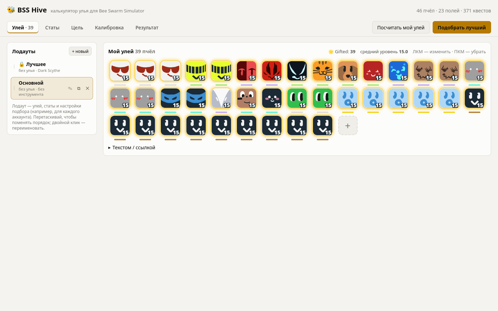
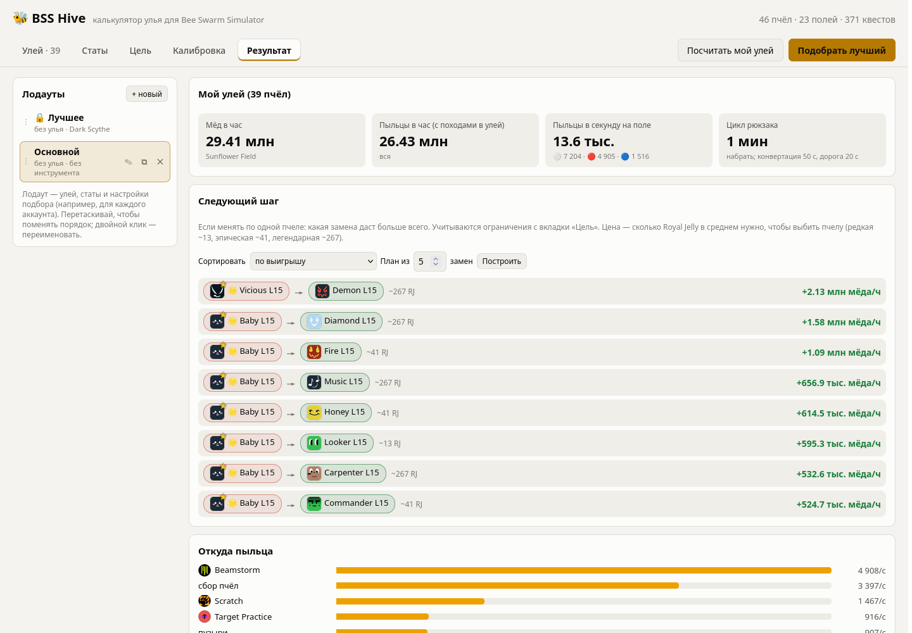

<div align="center">

# 🐝 BSS Hive

**Калькулятор и подбор улья для Bee Swarm Simulator (Roblox)**<br>
**Hive calculator & optimizer for Bee Swarm Simulator (Roblox)**


[🇷🇺 Русский](#-русский) · [🇬🇧 English](#-english)

 

</div>

---

## 🇷🇺 Русский

Сколько мёда и пыльцы в час даёт твой улей? На каком поле ему лучше всего? Какую пчелу заменить первой,
чтобы получить больше всего мёда? Какой улей собрать под квест? **BSS Hive** считает всё это за секунды —
прямо в браузере, без установки зависимостей.

### ✨ Возможности

- 🍯 **Оценка улья** — мёд/ч, пыльца/ч и пыльца/с на поле, цикл рюкзака, откуда берётся пыльца (сбор, токены, пассивки).
- 🧠 **Подбор лучшего улья** — под мёд, пыльцу, конкретный цвет или квест, с ограничениями и закреплёнными пчёлами.
- ➡️ **«Следующий шаг»** — какая одна замена пчелы даст больше всего и сколько Royal Jelly она примерно стоит.
- 🗺️ **Сравнение полей** — тот же улей на всех 23 полях, с учётом Field Boost.
- 📜 **План квестов** — сколько времени займёт квест и на каких полях его делать (369 квестов).
- 🎒 **Статы игрока** — из снаряжения, бейджей, амулетов и баффов, или просто цифрами из меню ⚙️ в игре.
- 👥 **Лодауты** — наборы «улей + статы» (например, по одному на аккаунт), встроенный лодаут «Лучшее».
- 🎯 **Калибровка** — подгонка модели по твоим замерам из игры.
- 🖼️ **Улей как в игре** — сетка лиц пчёл, Gifted-рамки, мутации; улей можно передать ссылкой или текстом:
  `Gifted Rad Bee x5 L10, Basic Bee x10 L8`.
- 🤖 **MCP-сервер** — спрашивай Claude прямо в чате: «какой улей лучше для Blue Flower Field?»

Данные — с BSS Wiki и из кода игры (кулдауны токенов, статы пчёл и мутации). Модель усредняет скорости
(без потиковой симуляции) и честно помечает, что посчитано приблизительно.

### 🚀 Запуск

Нужен только [Node.js](https://nodejs.org) 18+ — npm-пакеты не нужны.

```bash
git clone https://github.com/yawlick/bsshive.git
cd bsshive
./run.sh          # → http://localhost:8820 (откроется в браузере)
```

Без bash: `node site/server.mjs`, затем открыть http://localhost:8820.

### 🤖 Claude / MCP

```bash
claude mcp add bsshive -s user -- node /path/to/bsshive/mcp/server.mjs
```

Инструменты: `bss_evaluate`, `bss_optimize`, `bss_next_step`, `bss_compare_fields`, `bss_quest_plan`,
`bss_bees`, `bss_fields`, `bss_quests`, `bss_gear`, `bss_loadouts`, `bss_calibrate`.

### 📚 Подробнее

- [`docs/MODEL.md`](docs/MODEL.md) — как считает модель, структура проекта, что пока приблизительно.
- Обновить данные после патча игры:
  `node scripts/fetch-wiki.mjs && node scripts/build-data.mjs && node scripts/selftest.mjs`
- Проверки: `node scripts/selftest.mjs`

> Неофициальный фанатский проект, не связан с Onett и Roblox.

---

## 🇬🇧 English

How much honey and pollen per hour does your hive make? Which field suits it best? Which single bee should you
replace first for the biggest gain? What hive should you build for a quest? **BSS Hive** answers all of that in
seconds, right in your browser, with zero dependencies to install.

> The interface is in Russian for now.

### ✨ Features

- 🍯 **Hive evaluation**: honey/h, pollen/h and pollen/s on a field, backpack cycle, and where pollen comes from (gathering, tokens, passives).
- 🧠 **Best-hive optimizer**: for honey, pollen, a specific color or a quest, with constraints and locked bees.
- ➡️ **"Next step"**: which single bee swap gives the most, and roughly how much Royal Jelly it costs.
- 🗺️ **Field comparison**: the same hive on all 23 fields, with Field Boost support.
- 📜 **Quest planner**: how long a quest takes and which fields to do it on (369 quests).
- 🎒 **Player stats**: from gear, badges, amulets and buffs, or just the numbers from the in-game ⚙️ menu.
- 👥 **Loadouts**: "hive + stats" packs (e.g. one per account), plus a built-in "Best" loadout.
- 🎯 **Calibration**: fits the model to your own in-game measurements.
- 🖼️ **In-game-style hive**: bee faces grid, Gifted borders, mutations; share a hive as a link or as text:
  `Gifted Rad Bee x5 L10, Basic Bee x10 L8`.
- 🤖 **MCP server**: ask Claude in chat, e.g. "which hive is best for Blue Flower Field?"

Data comes from the BSS Wiki and from the game's code (token cooldowns, bee stats, mutations). The model averages
rates (no tick-by-tick simulation) and clearly marks anything that is only estimated.

### 🚀 Getting started

All you need is [Node.js](https://nodejs.org) 18+. There are no npm packages to install.

```bash
git clone https://github.com/yawlick/bsshive.git
cd bsshive
./run.sh          # → http://localhost:8820 (opens in your browser)
```

Without bash: `node site/server.mjs`, then open http://localhost:8820.

### 🤖 Claude / MCP

```bash
claude mcp add bsshive -s user -- node /path/to/bsshive/mcp/server.mjs
```

Tools: `bss_evaluate`, `bss_optimize`, `bss_next_step`, `bss_compare_fields`, `bss_quest_plan`,
`bss_bees`, `bss_fields`, `bss_quests`, `bss_gear`, `bss_loadouts`, `bss_calibrate`.

### 📚 More

- [`docs/MODEL.md`](docs/MODEL.md) (in Russian): how the model works, project layout, what is still approximate.
- Refresh data after a game update:
  `node scripts/fetch-wiki.mjs && node scripts/build-data.mjs && node scripts/selftest.mjs`
- Tests: `node scripts/selftest.mjs`

> Unofficial fan project, not affiliated with Onett or Roblox.
